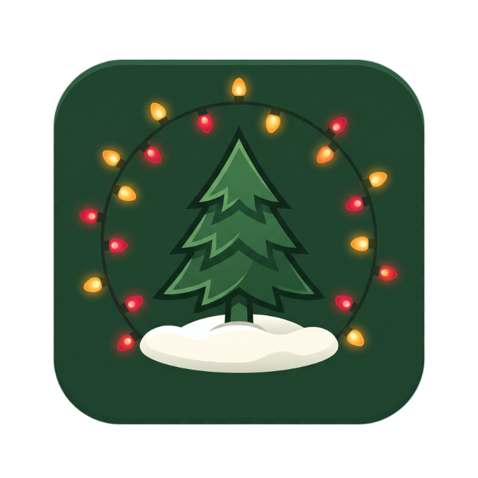
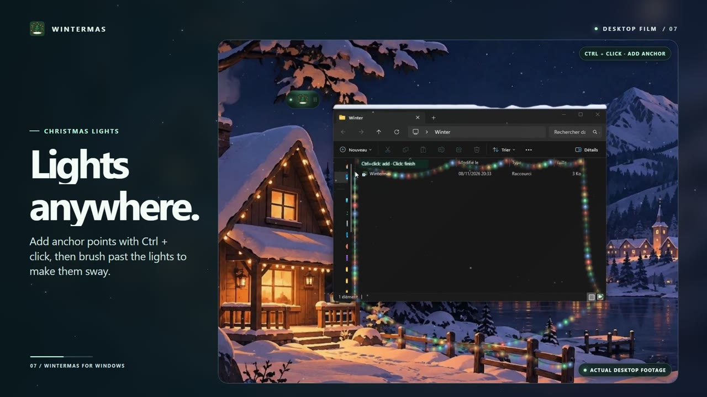

<p align="center">
  
</p>

<h1 align="center">Wintermas</h1>

<p align="center">An interactive Christmas desktop widget for Windows.</p>

<p align="center">
  
  
  
</p>

Wintermas brings snowfall and Christmas decorations to your existing desktop. Snow settles on window edges and can spill when you move or resize a window. The widget controls the effects and can be tucked away in the Windows system tray.

## Demo

[](./demo/demo.mp4)

[Watch or download the 47-second demo (MP4)](./demo/demo.mp4)

## Install

1. Get **Wintermas-Setup.exe** from [Releases](../../releases) when a build is available, or [build the installer](#build-from-source) locally.
2. Run the installer, choose a folder and select **Open Wintermas** when it finishes.
3. Click the widget and turn on **Christmas mode**, then **Snowfall**.

The installer targets Windows x64 and uses Microsoft Edge WebView2 for its interface. It installs for your Windows account. You can remove Wintermas through **Settings → Apps → Installed apps**.

## What you can do

| Feature | How to use it |
| --- | --- |
| Snowfall | Adjust **Intensity** and **Wind** in the widget. Snow can collect on open windows. **Snow on the taskbar** is on by default and has its own toggle. |
| Snowballs and snowmen | Use **Make snowball**, or click and drag across a snowbank to roll a ball. Drag and release a ball to throw it. Stack three snowballs to make a snowman. |
| Santa and gifts | Select **Send Santa** to watch the sleigh fly across the desktop and drop gifts. |
| Snowplow | Select **Snowplow** to clear snow along the taskbar. Use **Reset snow** to clear accumulated snow. |
| Garlands | Choose a light palette or custom color, then select **Hang garland**. Click to place the first anchor, use **Ctrl + click** to add anchors, and click to finish. |
| Christmas trees | Select **Place tree**, then click where you want it. **Clear decorations** removes the decorations you placed. |
| System tray | Drag the widget by its handle. Select **Hide to system tray** to tuck it away, double-click the tray icon to bring it back, or use its menu to quit. |

**Shortcut.** Press **Alt + Shift + B** over a snowbank to gather snow into a ball.

## Build from source

Build on Windows x64 with Node.js 22.12 or later, npm and the .NET Framework 4.x C# compiler. The installer build uses Windows PowerShell, `curl.exe` and `tar.exe` and downloads the pinned WebView2 SDK from NuGet. To use a local copy of that SDK, set `WINTERMAS_WEBVIEW2_SDK` to the path of its `.nupkg` file.

```powershell
npm.cmd ci
npm.cmd exec -- install-electron
npm.cmd start
```

To package the app and build its installer:

```powershell
npm.cmd run build
```

The build writes `dist/setup/Wintermas-Setup.exe`. Keep the generated `dist` folder out of Git.

## Release a new version

Update the version with `npm version patch --no-git-tag-version` (or choose `minor` or `major`). Update the version shown in the local badge at `.github/version.svg` and its alt text in this README, then commit and push to `main`. GitHub Actions skips versions with an existing `vX.Y.Z` tag. For a new version, it builds the installer and publishes it in a GitHub Release with a tag pointing to the built commit.

## Project layout

| Path | Purpose |
| --- | --- |
| `main.js`, `preload.cjs` | Electron windows, settings, system tray and communication with the interface |
| `ui/` | Widget interface, desktop overlay, snow effects and decoration artwork |
| `native/` | Windows helper that tracks window and taskbar geometry |
| `setup/`, `scripts/` | WebView2 installer interface and build scripts |
| `demo/` | Desktop demo video and preview image |

## License

Copyright © amiayweb.

Wintermas source code is available under the [PolyForm Noncommercial License 1.0.0](./LICENSE). You may use, modify, and share the software for permitted noncommercial purposes under the terms of the license. Commercial use requires separate permission from amiayweb.

## Acknowledgments

Wintermas was inspired by [KoiArt](https://koiart.app/), a desktop effects app for macOS.
